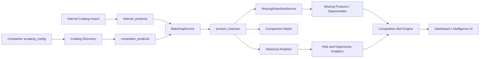

# Plateforme d'Intelligence Concurrentielle pour E-Commerce

Backend API pour une plateforme de surveillance des prix en temps réel avec analyse concurrentielle.

## 🚀 Technologies

- **Python 3.11+**
- **FastAPI** - Framework web moderne et rapide
- **SQLAlchemy** - ORM pour la gestion de base de données
- **MySQL** - Base de données relationnelle
- **Redis** - Cache et backend pour Celery
- **Celery** - Tâches asynchrones
- **RabbitMQ** - Message broker pour Celery
- **Pydantic** - Validation de données
- **Alembic** - Migrations de base de données

## 📁 Structure du Projet

```
backend/
├── app/
│   ├── main.py                 # Point d'entrée FastAPI
│   ├── config.py               # Configuration (legacy)
│   ├── dependencies.py         # Dépendances FastAPI
│   ├── core/                   # Modules core
│   ├── api/                    # Routes API
│   ├── models/                 # Modèles SQLAlchemy
│   ├── services/               # Logique métier
│   ├── scraping/               # Modules de scraping
│   ├── processing/             # Traitement de données
│   ├── scheduler/               # Configuration Celery
│   ├── cache/                  # Gestion du cache Redis
│   ├── monitoring/             # Monitoring et métriques
│   └── utils/                  # Utilitaires
├── alembic/                    # Migrations Alembic
├── tests/                      # Tests unitaires
├── docker/                     # Configuration Docker
└── requirements.txt            # Dépendances Python
```

## 🛠️ Installation

### Prérequis

- Python 3.11+
- MySQL 8.0+
- Redis
- RabbitMQ

### Installation locale

1. Cloner le repository
2. Créer un environnement virtuel :
```bash
python -m venv venv
source venv/bin/activate  # Sur Windows: venv\Scripts\activate
```

3. Installer les dépendances :
```bash
pip install -r requirements.txt
```

4. Configurer les variables d'environnement :
```bash
cp .env.example .env
# Éditer .env avec vos configurations
```

5. Initialiser la base de données :
```bash
alembic upgrade head
```

6. Lancer l'application :
```bash
uvicorn app.main:app --reload
```

## 🐳 Docker

### Lancer avec Docker Compose

```bash
cd docker
docker-compose up --build
```

Cela lancera :
- **Backend API** sur http://localhost:8000
- **MySQL** sur port 3306
- **Redis** sur port 6379
- **RabbitMQ** sur port 5672 (Management UI sur http://localhost:15672)
- **Celery Worker** pour les tâches asynchrones
- **Celery Beat** pour les tâches planifiées

### Documentation API

Une fois l'application lancée, accédez à :
- **Swagger UI** : http://localhost:8000/docs
- **ReDoc** : http://localhost:8000/redoc

## 📡 Endpoints API

### Authentication
- `POST /api/v1/auth/register` - Inscription
- `POST /api/v1/auth/login` - Connexion
- `GET /api/v1/auth/me` - Informations utilisateur

### Products
- `GET /api/v1/products` - Liste des produits
- `POST /api/v1/products` - Créer un produit
- `GET /api/v1/products/{id}` - Détails d'un produit
- `PUT /api/v1/products/{id}` - Modifier un produit
- `DELETE /api/v1/products/{id}` - Supprimer un produit

### Competitors
- `GET /api/v1/competitors` - Liste des concurrents
- `POST /api/v1/competitors` - Créer un concurrent
- `GET /api/v1/competitors/{id}` - Détails d'un concurrent
- `PUT /api/v1/competitors/{id}` - Modifier un concurrent
- `DELETE /api/v1/competitors/{id}` - Supprimer un concurrent

### Prices
- `POST /api/v1/prices` - Enregistrer un prix
- `GET /api/v1/prices/history/{product_id}` - Historique des prix
- `GET /api/v1/prices/current/{product_id}` - Prix actuels
- `GET /api/v1/prices/statistics/{product_id}` - Statistiques de prix

### Analytics
- `GET /api/v1/analytics/trends/{product_id}` - Tendances de prix
- `GET /api/v1/analytics/comparison/{product_id}` - Comparaison concurrentielle
- `GET /api/v1/analytics/insights` - Insights marché

### Scraping
- `POST /api/v1/scraping/trigger/{competitor_id}` - Déclencher un scraping
- `GET /api/v1/scraping/jobs/{job_id}` - Statut d'un job de scraping

### Monitoring
- `GET /api/v1/monitoring/health` - Health check
- `GET /api/v1/monitoring/metrics` - Métriques système

## 🔐 Authentification

L'API utilise JWT (JSON Web Tokens) pour l'authentification. Après connexion, inclure le token dans les en-têtes :

```
Authorization: Bearer <access_token>
```

## 📊 Base de Données

### Modèles principaux

- **User** - Utilisateurs de la plateforme
- **Product** - Produits à surveiller
- **Competitor** - Sites concurrents
- **Price** - Historique des prix
- **Alert** - Alertes de changement de prix
- **ScrapingJob** - Jobs de scraping

### Migrations

Utiliser Alembic pour les migrations :

```bash
# Créer une nouvelle migration
alembic revision --autogenerate -m "Description"

# Appliquer les migrations
alembic upgrade head

# Revenir en arrière
alembic downgrade -1
```

## 🔄 Tâches Asynchrones (Celery)

Les tâches Celery sont configurées pour :
- Scraping de prix
- Génération d'alertes
- Rapports analytiques quotidiens

### Lancer Celery Worker

```bash
celery -A app.scheduler.celery_app worker --loglevel=info
```

### Lancer Celery Beat (scheduler)

```bash
celery -A app.scheduler.celery_app beat --loglevel=info
```

## 🧪 Tests

```bash
pytest
```

## 📝 Logging

Les logs sont structurés en JSON et écrits dans `logs/app.log`. Le niveau de log est configurable via `LOG_LEVEL` dans `.env`.

## 🔧 Configuration

Toutes les configurations sont dans `.env`. Voir `.env.example` pour les variables disponibles.

## 📄 Licence

Ce projet est développé pour une plateforme d'intelligence concurrentielle.

---

## Competitive Intelligence Architecture



## `scraping_config` JSON

Each competitor can define site-specific discovery, extraction, retry, and anti-blocking rules in `competitors.scraping_config`.

```json
{
  "platform": "generic",
  "catalog": {
    "base_url": "https://competitor.example",
    "category_urls": ["https://competitor.example/category/laptops"],
    "product_link_selector": "a.product-card",
    "product_link_attr": "href",
    "product_url_regex": "/product/",
    "next_page_selector": "a[rel='next']",
    "max_pages": 50,
    "max_urls": 10000,
    "max_extract": 5000,
    "title_selector": "h1.product-title",
    "price_selector": ".price .amount",
    "availability_selector": ".stock-status",
    "image_selector": ".product-gallery img",
    "brand_selector": "[data-brand]",
    "sku_selector": ".sku",
    "gtin_selector": "[itemprop='gtin13']",
    "category_selector": ".breadcrumb li:last-child",
    "currency": "EUR",
    "timeout_s": 25,
    "retry_count": 3,
    "backoff_base_s": 0.75,
    "rate_limit_per_minute": 20,
    "retryable_status_codes": [408, 429, 500, 502, 503, 504],
    "user_agents": ["Mozilla/5.0 CompetitiveIntelligenceDemo/1.0"],
    "block_detection_patterns": ["captcha", "access denied", "verify you are human"]
  }
}
```

### Field explanations

- `platform`: adapter name. Supported: `generic`, `shopify`, `woocommerce`, `prestashop`.
- `category_urls`: catalogue/listing pages used for discovery.
- `product_link_selector`: CSS selector used to find product links on listing pages.
- `product_url_regex`: optional filter to keep only real product URLs.
- `next_page_selector`: CSS selector for pagination.
- `max_pages`, `max_urls`, `max_extract`: crawl safety limits.
- `title_selector`, `price_selector`, `availability_selector`: product detail selectors.
- `brand_selector`, `sku_selector`, `gtin_selector`, `category_selector`: fields used to improve matching.
- `timeout_s`: HTTP timeout per request.
- `retry_count`, `backoff_base_s`, `retryable_status_codes`: exponential backoff strategy.
- `rate_limit_per_minute`: real request throttling. Defaults to the competitor model value.
- `user_agents`: rotation pool for anti-blocking.
- `block_detection_patterns`: HTML patterns that mark a response as blocked/captcha.

### CSS selector example

```json
{
  "catalog": {
    "product_link_selector": ".products-grid a.product-item-link",
    "next_page_selector": "a.action.next",
    "title_selector": "h1.page-title span",
    "price_selector": "[data-price-type='finalPrice'] .price",
    "availability_selector": ".stock span",
    "sku_selector": ".product.attribute.sku .value"
  }
}
```

### API/feed import example

```json
{
  "source": {
    "source_type": "feed",
    "source_url": "https://shop.example/products.csv",
    "name": "Main CSV feed",
    "config": {
      "max_items": 10000,
      "timeout_s": 30,
      "user_agent": "CompetitiveIntelligenceBot/1.0"
    }
  }
}
```

### Anti-blocking and troubleshooting

- Prefer sitemap/feed discovery when available.
- Use conservative `rate_limit_per_minute` values.
- Keep `max_pages` and `max_extract` bounded during demos.
- If you see `403` or `429`, reduce rate limits and rotate user agents.
- If the catalogue is empty, check `product_link_selector`, `product_url_regex`, and `base_url`.
- If prices are null, verify that the price is server-rendered and adjust `price_selector`.
- If Celery tasks remain pending, start Redis/RabbitMQ and the Celery worker.

## Matching Engine

`MatchingService` links `internal_products` to `competitor_products` using GTIN, SKU, brand/token/category similarity, then RapidFuzz/TF-IDF fallback. Every match stores `confidence_score`, `matching_method`, `explanation`, and `review_status`.

## Missing Product Detection

`MissingDetectionService` computes `missing_products` and `unmatched_internal_products`. These records feed the Intelligence dashboard, opportunities, and competitive alerts.

## Historical Analytics

`GET /api/v1/analytics/comparison/{product_id}?days=30` preserves the old latest-price response and adds `historical_gap_evolution`, `historical_snapshots`, `cheapest_competitor`, `most_expensive_competitor`, `average_market_price`, `price_position`, `volatility_score`, `trend_direction`, `gain_loss_estimation`, and `competitor_ranking`.

```json
{
  "product_id": 12,
  "average_market_price": 94.5,
  "price_position": "above market",
  "volatility_score": 0.18,
  "trend_direction": "decreasing",
  "gain_loss_estimation": {
    "potential_revenue_loss": 7.5,
    "estimated_competitiveness_risk": "medium"
  }
}
```

## Risk and Opportunity Analytics

Additional endpoints:

- `GET /api/v1/analytics/products-at-risk?days=30`
- `GET /api/v1/analytics/opportunity-products?days=30`
- `GET /api/v1/analytics/competitor-aggressiveness`
- `GET /api/v1/analytics/opportunities?competitor_id=1`

Risk logic considers cheaper competitors, pressure score, 7/30 day variation, volatility, and downward trend. Opportunity logic considers competitor unavailability, internal price advantage, market rise, and margin potential.

## Alerts System

Competitive alert rules support `competitor_undercut`, `missing_internal_opportunity`, and `sudden_price_drop`. Run `POST /api/v1/ci-alerts/evaluate` to generate alerts.

## Testing and Coverage

```bash
cd backend
pytest
pytest --cov=app --cov-report=term-missing
```

Coverage is configured in `.coveragerc` with an 80% target for services and catalog adapters.
